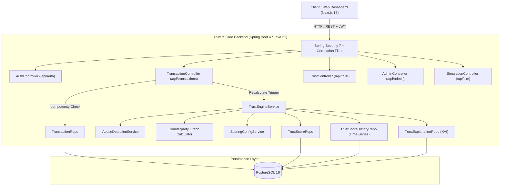

# Trustra

An institutional-grade **Trust Scoring & Risk Engine** with real-time fraud detection, graph network influence propagation, idempotent financial transactions, and explainable audit trails - engineered with **Spring Boot 4 (Java 21)**, **PostgreSQL**, and **Next.js 15 (React 19)**.

[](https://github.com/Antiz1/Trustra/actions/workflows/ci.yml)
[](https://www.oracle.com/java/)
[](https://spring.io/projects/spring-boot)
[](https://nextjs.org/)
[](LICENSE)

---

## Architecture Overview



---

## Key Fintech Features

### 1. Financial Transaction Integrity & Idempotency
- **Idempotency Keys**: Guarantees exactly-once execution on payment creation via `Idempotency-Key` HTTP header. Duplicate requests replay the original transaction with zero side-effects; conflicting payloads trigger `409 Conflict`.
- **Arbitrary Precision**: Currency amounts stored using `BigDecimal` (`NUMERIC(19, 2)`) with non-negative constraints.
- **High-Throughput Indexing**: Optimized compound indexes on `(sender_id, created_at)` and `(receiver_id, created_at)`.

### 2. Explainable AI & Adverse Action Compliance
- **Factor Attribution**: Every recalculation decomposes score changes into exact contributions (Success Rate, Dispute Rate, Feedback Rating, Network Influence, Inactivity Decay, Abuse Penalties).
- **Time-Series Audit Trail**: Every score change persists an immutable snapshot in `trust_score_history` with timestamps and trigger reasons (`TRANSACTION_EVENT`, `FEEDBACK_EVENT`, `MANUAL_API_TRIGGER`, `SCHEDULED_RECALCULATION`).

### 3. Dynamic Risk Scoring Model
```
Trust Score = clamp[0, 100]( Behavioral Score + Network Impact - Inactivity Decay - Abuse Penalties )
```
- **Dynamic Config**: Scoring weights and penalty multipliers are hot-configurable in real time via the Admin API without service restarts.

### 4. Graph Network Influence Propagation
- Real-time counterparty graph analysis evaluates second-degree risk. Interacting with high-trust counterparties elevates user trust; trading within suspicious clusters penalizes reputation.

### 5. Multi-Rule Real-Time Abuse Detection
- **SPIKE**: Flags sudden volume bursts exceeding $5\times$ the 30-day moving average.
- **FAKE_FEEDBACK**: Flags reputation farming (> 15 feedback submissions in 24 hours).
- **CLUSTER**: Uncovers sybil rings and circular trading ($\ge 20$ transactions among $\le 2$ counterparties).

### 6. Production Security & Observability
- **Spring Security 7 + Stateless JWT**: Secure authentication with role-based authorization (`ROLE_ADMIN`, `ROLE_USER`).
- **Standardized RFC 7807 Errors**: Unified error payload with machine-readable error codes, timestamp, and path.
- **Distributed Tracing**: `X-Correlation-ID` header injected and logged in MDC context.
- **Spring Boot Actuator**: Health, info, and metric endpoints exposed at `/actuator/health`.

---

## Tech Stack

| Layer | Technology | Version |
|---|---|---|
| **Backend Runtime** | Java OpenJDK | 21 |
| **Framework** | Spring Boot | 4.0.3 |
| **Security** | Spring Security, JJWT (HMAC-SHA256) | 7.0.3 / 0.12.6 |
| **Data & ORM** | Spring Data JPA, Hibernate, HikariCP | 7.2.4 |
| **Database** | PostgreSQL | 16 |
| **API Documentation** | OpenAPI 3.0 / Swagger UI | SpringDoc 3.0.1 |
| **Frontend** | Next.js App Router, React, Tailwind CSS | 15.5 / 19.0 |
| **Containerization** | Docker, Docker Compose | Multi-stage |
| **CI/CD** | GitHub Actions | Ubuntu Latest |

---

## API Reference

### Authentication
| Method | Endpoint | Description | Auth Required |
|---|---|---|---|
| `POST` | `/api/auth/token` | Obtain JWT bearer token | Public |

*Demo Credentials: `admin` / `admin123` (Admin Role), `user` / `password` (User Role)*

### Trust & Audit
| Method | Endpoint | Description | Auth Required |
|---|---|---|---|
| `GET` | `/api/trust/{userId}` | Get current trust score and level | Public |
| `GET` | `/api/trust/{userId}/explanations` | Get latest explanation trail | Public |
| `GET` | `/api/trust/{userId}/history` | Get time-series score history | Public |
| `POST` | `/api/trust/{userId}/recalculate` | Trigger manual recalculation | Public |
| `POST` | `/api/trust/recalculate-all` | Trigger network-wide recalculation | Public |

### Transactions & Ledger
| Method | Endpoint | Description | Headers |
|---|---|---|---|
| `POST` | `/api/transactions` | Create an idempotent payment | `Idempotency-Key` (Optional) |
| `GET` | `/api/transactions?userId={id}` | Get transaction history for user | None |
| `GET` | `/api/transactions/receiver-trust?receiverId={id}` | Pre-transaction trust check | None |

### Feedback & Abuse
| Method | Endpoint | Description | Auth Required |
|---|---|---|---|
| `POST` | `/api/feedback` | Submit transaction review | Public |
| `GET` | `/api/abuse/{userId}` | Get active abuse flags | Public |
| `GET` | `/api/network/{userId}` | Get counterparty trust breakdown | Public |

### Admin Configuration
| Method | Endpoint | Description | Auth Required |
|---|---|---|---|
| `GET` | `/api/admin/config` | Retrieve current scoring weights | `ROLE_ADMIN` / API Key |
| `PUT` | `/api/admin/config` | Update scoring weights in real time | `ROLE_ADMIN` / API Key |

### Simulation & Stress Testing
| Method | Endpoint | Description | Auth Required |
|---|---|---|---|
| `POST` | `/api/sim/init` | Seed $N$ baseline users | Public |
| `POST` | `/api/sim/normal` | Simulate normal activity flow | Public |
| `POST` | `/api/sim/malicious` | Trigger sybil cluster scenario | Public |
| `POST` | `/api/sim/spike/{userId}` | Trigger sudden transaction burst | Public |
| `GET` | `/api/sim/stats` | Get network-wide simulation stats | Public |

---

## Quickstart Guide

### Option 1: One-Command Docker Compose (Recommended)

Run the full stack (PostgreSQL + Spring Boot Backend + Next.js Frontend):

```bash
docker compose up --build
```

- **Frontend Dashboard**: `http://localhost:3000`
- **Backend API & Swagger UI**: `http://localhost:8080/swagger-ui.html`
- **PostgreSQL**: `localhost:5432` (database: `trustra`, user: `postgres`, pass: `postgrespassword`)

---

### Option 2: Local Development Setup

#### 1. Database
Ensure a local PostgreSQL instance is running with a database named `trustra`:

```bash
# Optional: Seed initial schema and named demo users
psql -d trustra -U postgres -f backend/sql/schema.sql
psql -d trustra -U postgres -f backend/sql/local-manual-test-queries.sql
```

#### 2. Backend (Spring Boot)
```bash
cd backend

# Build and execute all tests
./mvnw clean test

# Run application locally
./mvnw spring-boot:run
```
Swagger UI will be available at: `http://localhost:8080/swagger-ui.html`

#### 3. Frontend (Next.js)
```bash
cd frontend

# Install dependencies and launch dev server
npm install
npm run dev
```
Dashboard will be available at: `http://localhost:3000`

---

## Testing & Quality Assurance

Run the comprehensive test suite (Unit Tests, Slice Tests, MockMvc Integration Tests):

```bash
cd backend
./mvnw test
```

### Test Coverage Highlights:
- `TrustEngineServiceTests`: Mathematical scoring verification, clamping boundaries, inactivity decay, penalty weighting.
- `AbuseDetectionServiceTests`: Velocity checks, review-bombing heuristics, graph cluster collusion detection.
- `TrustraIntegrationTests`: End-to-end idempotent transaction execution, conflict resolution (409), time-series audit trail recording, JWT authentication & admin configuration updates.

---

## System Design Document

For in-depth architectural details, scaling strategies for 10M+ users (Kafka streaming, Redis caching, graph partitioning), regulatory compliance, and threat modeling, refer to [FINTECH_SYSTEM_DESIGN.md](file:///c:/dev/trustra/FINTECH_SYSTEM_DESIGN.md).
