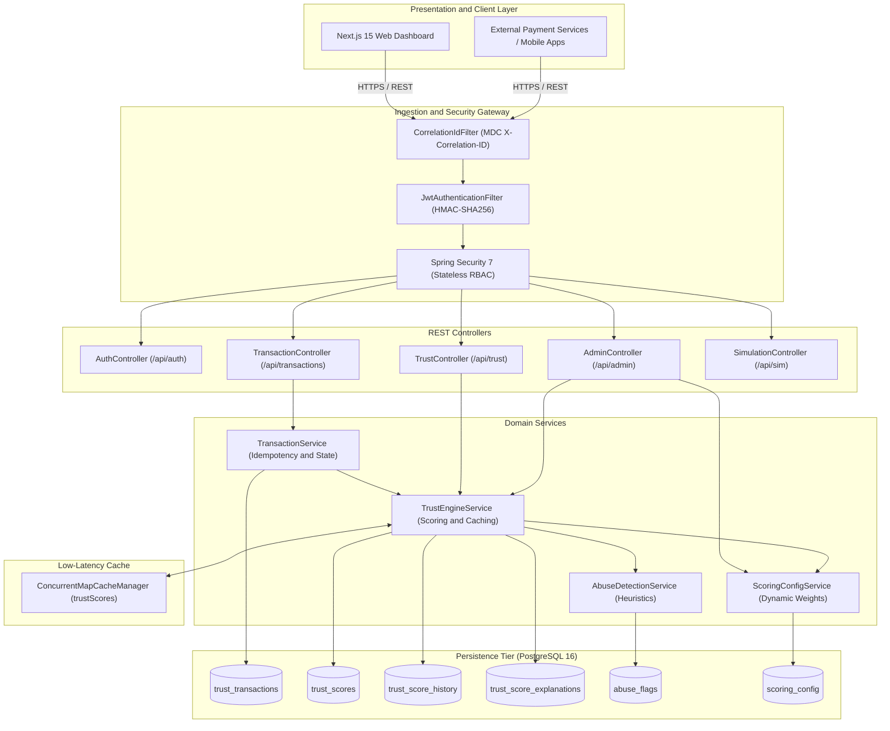
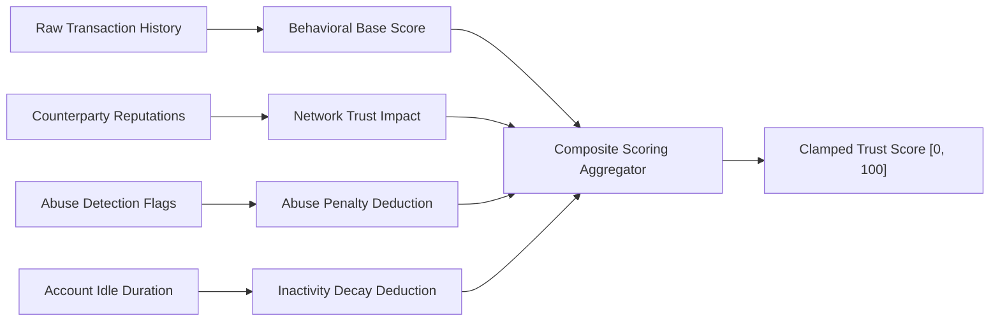
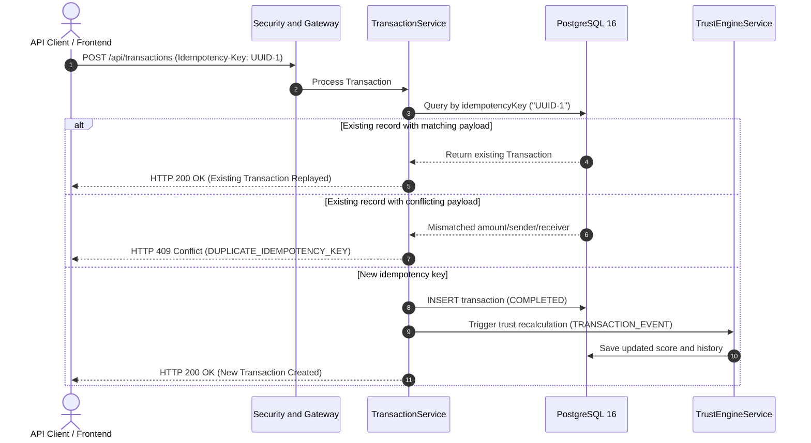
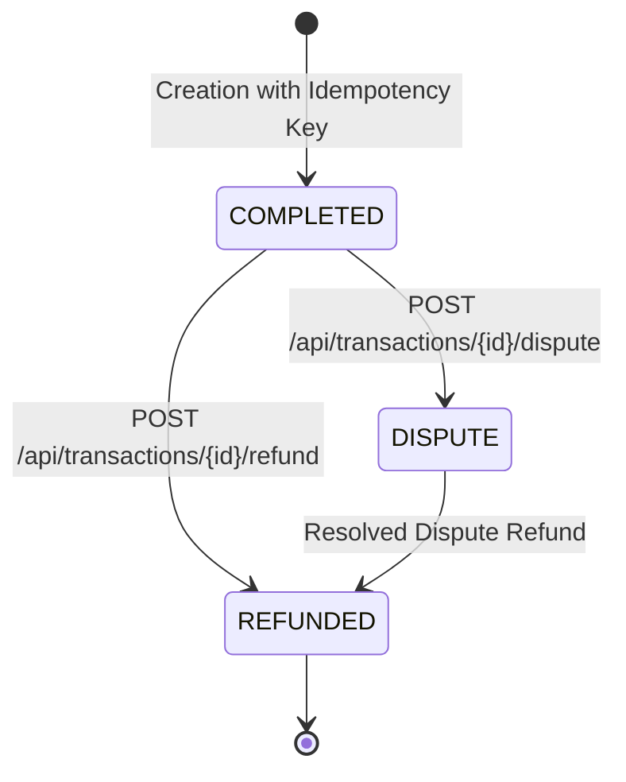
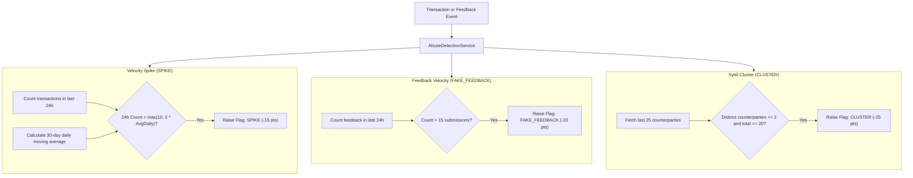
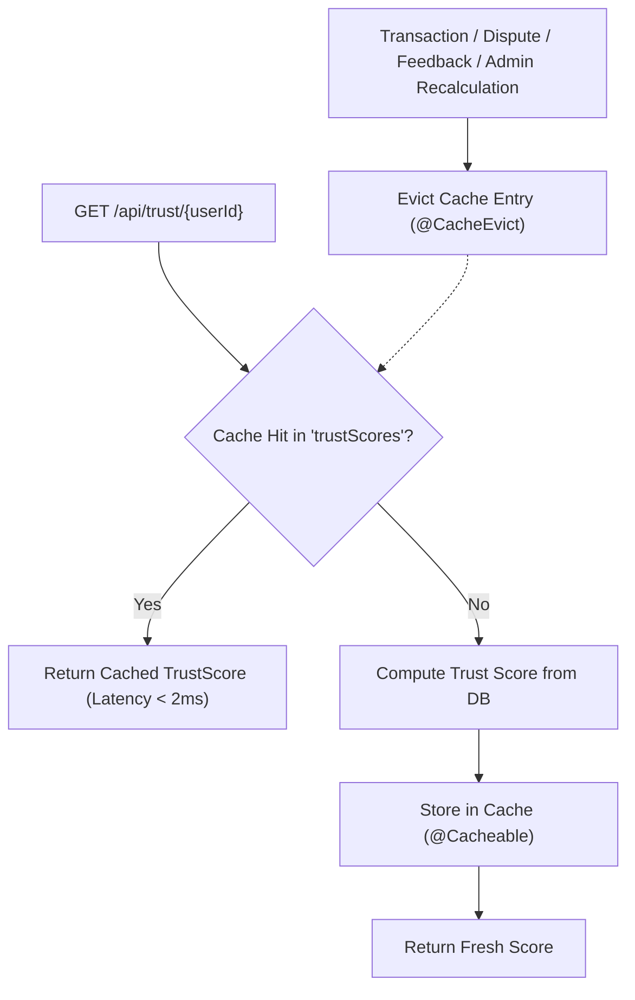
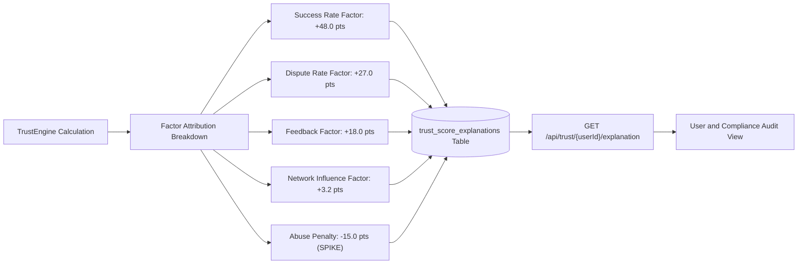
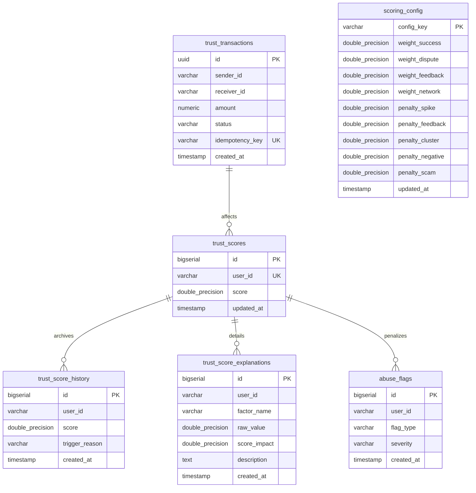
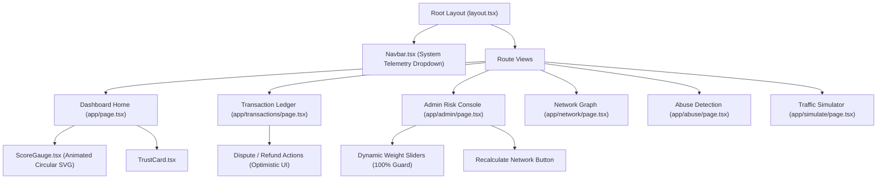

# Trustra: Platform Engineering and Architecture Guide

## 1. Executive Summary

Trustra is an institutional-grade Trust Scoring and Risk Engine engineered for peer-to-peer payment networks, digital marketplaces, and financial platforms. In distributed financial architectures, counterparty default, fraudulent chargebacks, and collusion rings present existential risks to platform liquidity and user trust.

Trustra solves these challenges through:
- Real-time scoring evaluating transaction success rates, dispute metrics, and user ratings.
- Graph-based network trust propagation accounting for second-degree counterparty reputation.
- Automated real-time heuristic abuse detection identifying velocity spikes, fake feedback rings, and circular wash-trading clusters.
- High-throughput idempotency guarantees preventing double-spend and duplicate ledger entries.
- In-memory caching providing sub-5 millisecond read latencies for trust evaluations.
- Explainable AI factor decomposition satisfying regulatory Adverse Action Notice mandates (FCRA / Equal Credit Opportunity Act).
- Dynamic runtime scoring configuration allowing risk teams to calibrate weights and penalties without service downtime.

---

## 2. System Architecture and Request Flow

The platform is structured as a decoupled, multi-tier system comprising a Spring Boot 4 / Java 21 core risk engine, a PostgreSQL 16 persistence tier, and a Next.js 15 / React 19 operator dashboard.



### 2.1 Request Processing Pipeline

1. **Correlation Tracking**: Every inbound HTTP request passes through `CorrelationIdFilter`. It extracts an existing `X-Correlation-ID` header or generates a UUID, binding it to SLF4J MDC context for distributed tracing across logs.
2. **Authentication and Authorization**: `JwtAuthenticationFilter` validates bearer tokens signed with HMAC-SHA256. Public endpoints (Swagger, Actuator, Simulation) bypass token requirements; user actions require valid bearer tokens, and administrative configuration requires `ROLE_ADMIN`.
3. **Idempotency Gate**: Financial transactions evaluate the `Idempotency-Key` header. Existing matching keys replay original results; conflicting keys are rejected with `409 Conflict`.
4. **Scoring and Cache Resolution**: Lookups for trust scores hit the in-memory cache first (`@Cacheable`). Cache misses compute scores, write to PostgreSQL, and populate the cache. Mutating actions (`POST /api/transactions`, disputes, refunds, feedback) automatically evict or update the cache.

---

## 3. Mathematical Scoring Engine

The trust score represents an entity creditability index bounded within `[0, 100]`.



### 3.1 Composite Score Formulation

The final score $\mathcal{S} \in [0, 100]$ is computed as:

$$\mathcal{S} = \text{clamp}_{[0, 100]}\left( \mathcal{B}_{score} + \mathcal{N}_{impact} - \mathcal{P}_{abuse} - \mathcal{P}_{inactivity} \right)$$

Where each component is defined below.

### 3.2 Behavioral Base Score ($\mathcal{B}_{score}$)

The base score reflects direct transactional performance:

$$\mathcal{B}_{score} = \left(\frac{\text{Success Rate}}{100} \times W_{success}\right) + \left(\frac{100 - \text{Dispute Rate}}{100} \times W_{dispute}\right) + \left(\frac{\text{Rating}}{5.0} \times W_{feedback}\right) - (N_{neg} \times P_{neg}) - (N_{scam} \times P_{scam})$$

- $\text{Success Rate} = \frac{\text{Completed Transactions}}{\text{Total Transactions}} \times 100$
- $\text{Dispute Rate} = \frac{\text{Disputed Transactions}}{\text{Total Transactions}} \times 100$
- $\text{Rating} \in [1.0, 5.0]$: Arithmetic mean of submitted feedback. Default baseline is 3.0 when zero feedback records exist.
- $W_{success}$: Transaction success weight (default: 50.0).
- $W_{dispute}$: Dispute weight (default: 30.0).
- $W_{feedback}$: User feedback weight (default: 20.0).
- $P_{neg}$: Direct deduction per negative rating (default: 8.0 points).
- $P_{scam}$: Severe penalty for scam-tagged feedback (default: 15.0 points).

### 3.3 Graph Network Influence ($\mathcal{N}_{impact}$)

Direct ratings can be forged through sybil accounts. Trustra counteracts this by measuring counterparty quality:

$$\bar{\mathcal{S}}_{partners} = \frac{1}{|P|} \sum_{p \in P} \text{Score}(p)$$

$$\mathcal{N}_{impact} = \left(\frac{\bar{\mathcal{S}}_{partners}}{100} - 0.5\right) \times W_{network}$$

- $P$: Set of unique counterparties interacting with the user over the evaluation window.
- $W_{network}$: Network influence multiplier (default: 15.0).
- If a user transacts with pristine counterparties (mean score = 90), $\mathcal{N}_{impact} = (0.9 - 0.5) \times 15 = +6.0$ points.
- If transacting with compromised actors (mean score = 20), $\mathcal{N}_{impact} = (0.2 - 0.5) \times 15 = -4.5$ points.

### 3.4 Inactivity Decay ($\mathcal{P}_{inactivity}$)

Trust is perishable. Dormant accounts lose score certainty:

$$\mathcal{P}_{inactivity} = \begin{cases} 
0, & \text{if } \text{Days Inactive} \le 30 \\
\min\left(20.0, \frac{\text{Days Inactive}}{10}\right), & \text{if } \text{Days Inactive} > 30 
\end{cases}$$

### 3.5 Dynamic Configuration Management

All weights and penalty constants are managed via `ScoringConfigService`. Operators can adjust parameters in real time via `PUT /api/admin/config`:

```json
{
  "weightTransactionVolume": 50.0,
  "weightDisputeRate": 30.0,
  "weightFeedbackRating": 20.0,
  "weightNetworkScore": 15.0,
  "penaltyVelocitySpike": 15.0,
  "penaltyFakeFeedback": 20.0,
  "penaltyClusterRisk": 25.0,
  "penaltyNegativeFeedback": 8.0,
  "penaltyScamTag": 15.0
}
```

Updating configuration invalidates the trust score cache and recalculates downstream scores without server restarts.

---

## 4. Financial Transaction Integrity and Idempotency

In digital payments, network timeouts frequently cause client retries. Without strict idempotency, retries cause duplicate debits and corrupted ledger states.



### 4.1 State Machine Lifecycle

Transactions follow a strict financial state machine:



- `COMPLETED`: Initial successful clearing state upon submission.
- `DISPUTE`: Counterparty raises a transaction grievance. Triggers immediate `DISPUTE_EVENT` score recomputation, penalizing the recipient.
- `REFUNDED`: Funds returned to the originating sender. Recomputes dispute metrics.

### 4.2 Monetary Precision

All monetary fields use Java `BigDecimal` mapped to PostgreSQL `NUMERIC(19, 2)`:
- Floating point values (`float`, `double`) are banned to eliminate binary IEEE 754 rounding drift.
- Non-negative constraints (`amount > 0.00`) are enforced at database and bean validation layers.

---

## 5. Real-Time Fraud and Abuse Detection

Trustra runs three real-time fraud heuristic rules prior to score calculation:



1. **Velocity Spike (`SPIKE`)**: Protects against Account Takeover (ATO) and rapid wallet draining. Triggers when 24-hour volume exceeds 5 times the 30-day baseline.
2. **Review Velocity (`FAKE_FEEDBACK`)**: Detects reputation farming where compromised accounts submit bulk positive reviews in rapid succession.
3. **Sybil Cluster (`CLUSTER`)**: Identifies circular trading where two or three colluding accounts wash trade funds back and forth to artificially inflate transaction counts.

---

## 6. High-Performance Caching Architecture

Financial checkout flows require low-latency decisions. Trustra implements in-memory caching via Spring's `ConcurrentMapCacheManager` with automatic lifecycle synchronization:



### 6.1 Cache Invalidation Rules

- Direct transaction mutations invalidate both sender and receiver cache keys.
- Dispute transitions (`/api/transactions/{id}/dispute`) evict the receiver key and recalculate immediately.
- Global recalculation (`/api/admin/recalculate`) clears the entire cache region, ensuring zero stale data across nodes.

---

## 7. Explainable AI (XAI) and Regulatory Compliance

Under Section 615(a) of the Fair Credit Reporting Act (FCRA) and the EU AI Act, automated credit and risk determinations that result in adverse action must supply clear, understandable explanations.

Trustra satisfies this by computing discrete factor deltas on every calculation and storing them in `trust_score_explanations`:



### 7.1 Historical Auditability

Every score mutation records an immutable record in `trust_score_history`:
- Snapshot of the resulting score.
- Timestamp of calculation (`created_at`).
- Trigger reason (`TRANSACTION_EVENT`, `FEEDBACK_EVENT`, `DISPUTE_EVENT`, `MANUAL_API_TRIGGER`, `SCHEDULED_RECALCULATION`).

This allows compliance officers to answer: *"What was user X's exact score and risk factors when transaction Y was cleared 90 days ago?"*

---

## 8. Security and Observability

### 8.1 Authentication and Role-Based Access Control

Trustra uses stateless JWT authentication (`jjwt-api` 0.12.6) with HMAC-SHA256 signing:

| Role | Permissions | Endpoints |
|---|---|---|
| `ROLE_ADMIN` | Configuration read/write, global network recalculation | `/api/admin/**` |
| `ROLE_USER` | Transaction creation, dispute submission, score lookup | `/api/transactions/**`, `/api/trust/**`, `/api/feedback/**` |
| `ANONYMOUS` | Health check, documentation, simulation endpoints | `/actuator/**`, `/swagger-ui/**`, `/v3/api-docs/**`, `/api/sim/**` |

### 8.2 Distributed Tracing via Correlation ID

To support root-cause analysis across microservices:
1. `CorrelationIdFilter` inspects the inbound request for `X-Correlation-ID`.
2. If missing, it generates a fresh UUID.
3. The ID is injected into SLF4J MDC (`MDC.put("correlationId", id)`).
4. All application logs automatically include `[correlationId=UUID]`.
5. The ID is echoed in the `X-Correlation-ID` response header.

### 8.3 Standardized RFC 7807 Error Handling

All controller errors are caught by `GlobalExceptionHandler` returning RFC 7807 problem details:

```json
{
  "type": "about:blank",
  "title": "Conflict",
  "status": 409,
  "detail": "Duplicate transaction: Idempotency-Key already used with conflicting payload",
  "instance": "/api/transactions",
  "code": "DUPLICATE_IDEMPOTENCY_KEY",
  "timestamp": "2026-11-22T08:30:00Z"
}
```

---

## 9. Database Architecture and Schema Specification

The persistence layer uses PostgreSQL 16 with optimized compound indexes and constraints defined in `backend/sql/schema.sql`.



### 9.1 High-Performance Indexing Strategy

- `CREATE UNIQUE INDEX idx_transactions_idempotency ON trust_transactions(idempotency_key)`: Instant collision checking.
- `CREATE INDEX idx_transactions_receiver_status ON trust_transactions(receiver_id, status)`: Accelerates dispute and success rate queries.
- `CREATE INDEX idx_transactions_sender_created ON trust_transactions(sender_id, created_at DESC)`: Rapid 24-hour volume velocity calculations.
- `CREATE INDEX idx_history_user_created ON trust_score_history(user_id, created_at DESC)`: Fast pagination of time-series score trends.

---

## 10. Frontend Architecture (Next.js 15 & React 19)

The operator console is constructed with Next.js 15 App Router and Tailwind CSS, prioritizing operational visibility and real-time risk controls.



### 10.1 Key Frontend Features

1. **Live Operational Telemetry**: The top navigation bar features a system health status indicator reporting backend connection status, round-trip latency, and runtime environment.
2. **Animated Circular Score Gauge**: Custom SVG gauge rendering calibrated color arcs (emerald for scores 75-100, amber for 45-74, rose for 0-44) with dynamic stroke animations.
3. **Admin Risk Tuning Console**: Interactive sliders for transaction volume, dispute rate, and user feedback weights with automatic 100% allocation guards and live updates.
4. **Interactive Transaction Ledger**: Tabular ledger supporting one-click clipboard copying of transaction UUIDs and idempotency keys, coupled with instant inline "Dispute" and "Refund" state transitions.

---

## 11. Complete API Specification

### 11.1 Authentication Endpoints

#### Generate JWT Token
- **Endpoint**: `POST /api/auth/token`
- **Headers**: `Content-Type: application/json`
- **Request Payload**:
  ```json
  {
    "username": "admin",
    "password": "password"
  }
  ```
- **Response**: `200 OK`
  ```json
  {
    "token": "eyJhbGciOiJIUzI1NiJ9...",
    "type": "Bearer",
    "expiresIn": 86400
  }
  ```

### 11.2 Transaction Endpoints

#### Create Transaction
- **Endpoint**: `POST /api/transactions`
- **Headers**: `Idempotency-Key: <UUID>`, `Content-Type: application/json`
- **Request Payload**:
  ```json
  {
    "senderId": "alice",
    "receiverId": "bob",
    "amount": 250.00,
    "idempotencyKey": "9b1deb4d-3b7d-4bad-9bdd-2b0d7b3dcb6d"
  }
  ```
- **Responses**:
  - `200 OK`: Transaction recorded.
  - `409 Conflict`: Reused idempotency key with conflicting payment attributes.

#### Dispute Transaction
- **Endpoint**: `POST /api/transactions/{id}/dispute`
- **Response**: `200 OK` (Transitions status to `DISPUTE` and recomputes trust scores).

#### Refund Transaction
- **Endpoint**: `POST /api/transactions/{id}/refund`
- **Response**: `200 OK` (Transitions status to `REFUNDED`).

### 11.3 Trust and Explanation Endpoints

#### Get Trust Score
- **Endpoint**: `GET /api/trust/{userId}`
- **Response**: `200 OK`
  ```json
  {
    "userId": "bob",
    "score": 92.5,
    "status": "TRUSTED",
    "totalTransactions": 142,
    "successRate": 98.6,
    "disputeRate": 1.4,
    "averageRating": 4.8,
    "lastUpdated": "2026-11-22T08:30:00Z"
  }
  ```

#### Get Score Explanation (XAI)
- **Endpoint**: `GET /api/trust/{userId}/explanation`
- **Response**: `200 OK`
  ```json
  [
    {
      "factorName": "TRANSACTION_SUCCESS",
      "rawValue": 98.6,
      "scoreImpact": 49.3,
      "description": "High completed transaction volume"
    },
    {
      "factorName": "DISPUTE_METRICS",
      "rawValue": 1.4,
      "scoreImpact": 29.58,
      "description": "Low dispute rate below network threshold"
    }
  ]
  ```

#### Get Time-Series History
- **Endpoint**: `GET /api/trust/{userId}/history`
- **Response**: `200 OK` array of historical score snapshots with timestamps and trigger reasons.

### 11.4 Admin Configuration Endpoints

#### Get Scoring Configuration
- **Endpoint**: `GET /api/admin/config`
- **Headers**: `Authorization: Bearer <JWT>`

#### Update Scoring Configuration
- **Endpoint**: `PUT /api/admin/config`
- **Headers**: `Authorization: Bearer <JWT>`, `Content-Type: application/json`

#### Trigger Network Recalculation
- **Endpoint**: `POST /api/admin/recalculate`
- **Headers**: `Authorization: Bearer <JWT>`

---

## 12. Deployment and DevOps

### 12.1 Multi-Container Docker Stack

The application can be deployed using the root `docker-compose.yml`:

```bash
docker compose up --build -d
```

Services initialized:
- `db`: PostgreSQL 16 exposed on host port `5432`.
- `backend`: Spring Boot 4 running on OpenJDK 21, connected via HikariCP on port `8080`.
- `frontend`: Next.js 15 production build running on Node.js 20 Alpine on port `3000`.

### 12.2 GitHub Actions CI Pipeline

The CI workflow `.github/workflows/ci.yml` runs automated quality gates on every push:
1. **Backend Matrix**: Installs OpenJDK 21, executes `./mvnw clean test`, verifying unit and integration tests.
2. **Frontend Matrix**: Installs Node 20 dependencies, executes `npx tsc --noEmit` type checking, `npm run lint`, and `npm run build`.

---

## 13. Fintech Interview Deep-Dive Talking Points

When presenting Trustra in Staff or Principal engineering interviews:

1. **Eventual Consistency vs. ACID Guarantees**:
   Explain how financial transaction recording requires strict ACID transactions (via PostgreSQL row-level locks on idempotency keys), while trust score updates can be processed asynchronously or cached with read-through invalidation.
2. **Idempotency Fingerprinting**:
   Detail how idempotency keys are paired with a payload hash to detect replay vs. duplicate key collisions, returning a `409 Conflict` according to RFC 7807 specifications.
3. **Graph Clustering at Scale**:
   Discuss how the current counterparty query leverages database indexes for real-time calculations and how it migrates to Apache Flink and Neo4j / AWS Neptune as the graph reaches 100 million vertices.
4. **Regulatory Explainability**:
   Highlight how `trust_score_explanations` and `trust_score_history` satisfy FCRA Adverse Action and model risk governance standards.
